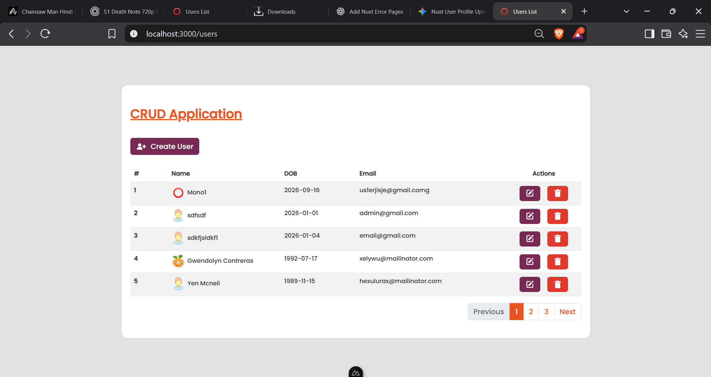

# Nuxt CRUD App 
 A simple crud application with all the basic features you have to know.

## Features
  1. Image Uplaod
  2. Password encoder
  3. Pagination links
  4. Flash messages
  5. Error pages to handle error code such as 404, 500 etc.

## Technolgies Used 
  1. Vue
  2. Next.js 
  3. MySQL database
  4. Node-express api's
  5. Developed in Visual studio code
  
## Screenshots 
<div style="display: flex;flex-direction: column; grid-gap: 10px;">
    <div style="display: flex; grid-gap: 10px;">
        
    </div>
</div>
<br>

## HOW TO USE?
```sh
git clone

npm install

# make sure api server is up and running
npm run dev
```


## Contributing

Pull requests are welcome. For major changes, please open an issue first
to discuss what you would like to change.

Please make sure to update tests as appropriate.
